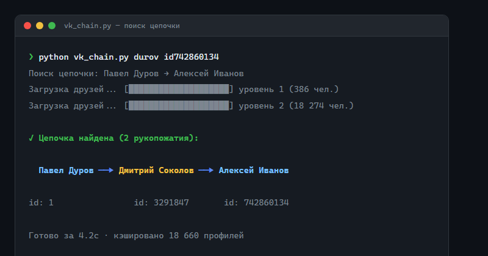
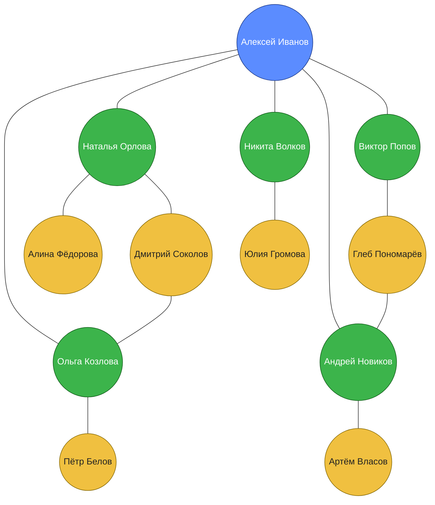
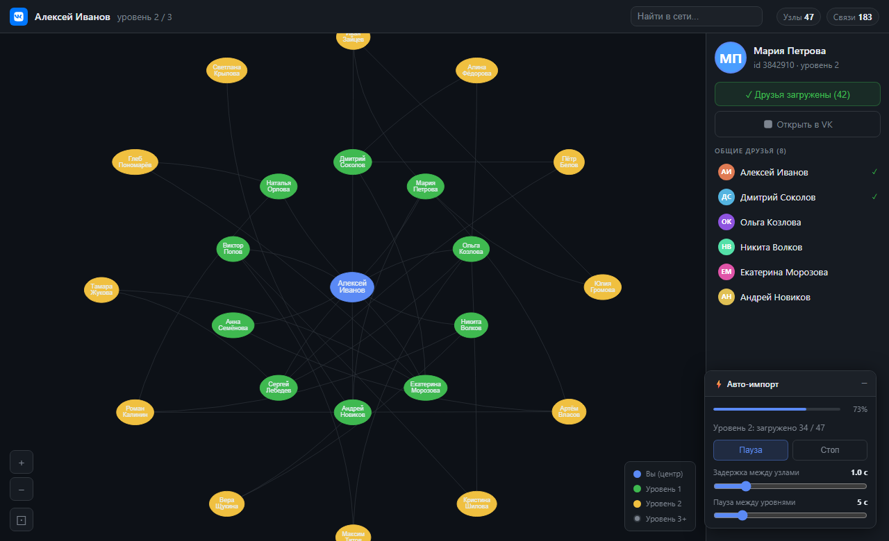
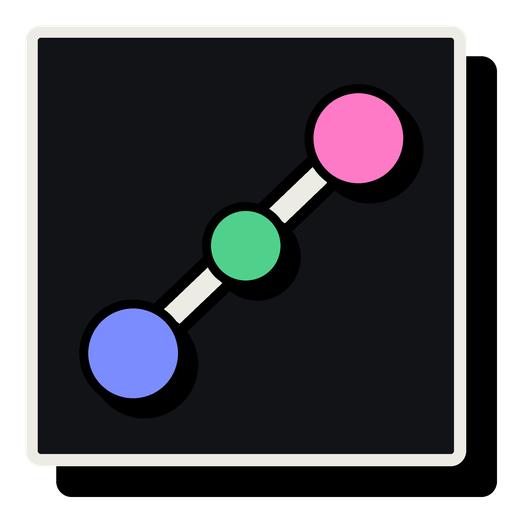

<div align="center">

# vk-chain

**Цепочки рукопожатий и интерактивный граф друзей ВКонтакте**

[](https://python.org)
[](LICENSE)
[](https://dev.vk.com)

Узнай, через сколько людей ты связан с любым пользователем ВКонтакте.  
Визуализируй сеть друзей прямо в браузере — кольцами, уровень за уровнем.

</div>

---

## Превью

### Поиск цепочки рукопожатий

```text
$ python vk_chain.py durov id742860134
Поиск цепочки: Павел Дуров → Алексей Иванов
Загрузка друзей...  [████████████████████] уровень 1 (386 чел.)
Загрузка друзей...  [████████████████████] уровень 2 (18 274 чел.)

✓ Цепочка найдена (2 рукопожатия):

  Павел Дуров ──▶ Дмитрий Соколов ──▶ Алексей Иванов
  id: 1             id: 3291847         id: 742860134

Готово за 4.2с · кэшировано 18 660 профилей
```

<!-- Снимок экрана, вернуть, когда картинки из репозитория снова будут отдаваться:
 -->

### Интерактивный граф (`explore.py`)

Схема того, что рисует граф (картинкой это было окно `explore.py`):



<!-- Снимок экрана, вернуть, когда картинки из репозитория снова будут отдаваться:
 -->

> Синий — центральный узел, зелёный — уровень 1 (прямые друзья), жёлтый — уровень 2 (друзья друзей). Граф строится автоматически, волна за волной.

---

## Приложение для Windows

Окно с графом, поиском и настройками — всё, что умеет `vk_chain.py`, но кнопками.

<!-- Логотип, вернуть, когда картинки из репозитория снова будут отдаваться:
<p align="center"></p> -->

**Установка:** скачай `vk-chain-setup-*.exe` со страницы [Releases](https://github.com/FalconTechDev/vk-chain/releases) и запусти. Ставится для текущего пользователя, права администратора не нужны.

При первом запуске открой **⚙ Настройки → Токен VK**, нажми «Получить токен в браузере», войди во ВКонтакте — адрес, на котором ты окажешься, целиком вставь в поле и нажми «Сохранить». Токен проверяется, и только потом сохраняется.

Что внутри:

| Режим | Что делает |
|---|---|
| **Цепочка** | кратчайший путь между двумя людьми; можно запросить несколько разных путей — каждый следующий обходит людей предыдущих |
| **Граф** | друзья и самые связанные с ними друзья друзей, до выбранного числа узлов |
| **Родня** | однофамильцы по корню фамилии (и по девичьей) среди **всех** друзей и всех друзей друзей, не от одного человека; кандидатов берётся до 4000 самых связанных с твоими друзьями |
| **Пересечения** | общие друзья нескольких людей: id или ссылку вписываешь сам, до пяти человек |
| **Круги общения** | друзья, разбитые на группы по тому, кто с кем знаком |

В графе:

- вид 3D и 2D; фото профилей на узлах и в карточке человека;
- цвет связей по уровням 1, 2 и 3 отдельно в покое и при наведении на узел;
- тумблер «Обрезать лишние связи» оставляет связи внутри кругов знакомых;
- цвета и формы узлов по уровням.

Экран выбирается в **Настройки → Основные → Экран**: окно выбранного размера, развёрнутое окно, без рамки или весь экран (**F11** переключает полный экран). То, что выбрано, запоминается, и при следующем запуске программа открывается так же. **Все настройки запоминаются** между запусками.

**Уведомления** включаются там же: когда долгий поиск закончился или окно не в фокусе, Windows покажет уведомление. При включении приходит пробное. Если его нет, проверь режим «Не беспокоить» и «Фокусировку» в Windows.

История поисков хранит параметры запроса, поэтому клик по записи повторяет поиск.

Работает без интернета, кроме самих запросов к VK: шрифты и React лежат внутри. Кэш, история и настройки хранятся в `%APPDATA%k-chain`, токен — в `~/.vk_chain_token`.

### Из исходников

```bash
pip install -r requirements.txt
python app.py
```

### Собрать установщик

```bash
python build.py
```

Нужны PyInstaller и [Inno Setup 6](https://jrsoftware.org/isdl.php). Сначала собирается программа, потом она один раз запускается в режиме самопроверки (окно открывается скрытым и проверяет, что страница поднялась без ошибок), и только после этого упаковывается `dist/vk-chain-setup-*.exe`.

### Проверки

```bash
python -m unittest tests.test_backend       # бэкенд, без сети
python tests/ui_selftest.py                 # интерфейс в настоящем движке, скрытым окном
```

---

## Что внутри

| Файл | Описание |
|---|---|
| `vk_chain.py` | Поиск кратчайшей цепочки (BFS с двух сторон), поиск родственников и однофамильцев, HTML-отчёты |
| `explore.py` | Интерактивный граф в браузере: загрузка уровнями, пауза/стоп, слайдеры скорости |
| `vk.py` | Обёртка над VK API с кэшированием, ретраями и учётом rate limit |
| `app.py` | Приложение для Windows: окно и всё, что за кнопками |
| `ui/source/` | Интерфейс приложения (разметка, логика, локальные шрифты и React) |
| `build.py`, `installer/` | Сборка программы и установщика |
| `assets/` | Логотип и иконка |
| `tests/` | Тесты бэкенда и интерфейса |

---

## Установка

**Требования:** Python 3.9+, токен VK с правами `friends`

```bash
git clone https://github.com/FalconTechDev/vk-chain
cd vk-chain
pip install requests
```

Других зависимостей нет — только стандартная библиотека Python и `requests`.

---

## Быстрый старт

### 1. Получи токен VK

Перейди на [vk.com/dev/access_token](https://vk.com/dev/access_token) и получи `access_token` с правом `friends`.

Сохрани его:

```bash
python vk_chain.py --token ТВОЙ_ТОКЕН --save
```

Токен сохраняется в `~/.vk_chain_token` и никогда не попадает в репозиторий.

---

### 2. Найти цепочку между двумя людьми

```bash
python vk_chain.py <user1> <user2>
```

`user1` и `user2` — VK ID, короткое имя или ссылка `vk.com/name`:

```bash
# Через короткие имена
python vk_chain.py durov id123456789

# Через ID
python vk_chain.py 1 742860134

# С HTML-отчётом (откроется в браузере)
python vk_chain.py durov id742860134 --html
```

**Результат:**
```
✓ Цепочка найдена (2 рукопожатия):

  Павел Дуров ──▶ Дмитрий Соколов ──▶ Алексей Иванов

  id: 1              id: 3291847         id: 742860134

Готово за 4.2с · кэшировано 18 660 профилей
```

---

### 3. Найти родственников и однофамильцев

```bash
# Найти всех с похожей фамилией среди друзей и друзей друзей
python vk_chain.py --relatives durov

# Поиск по корню фамилии (Иванов = Иванова = Ивановский)
python vk_chain.py --relatives durov --stem

# Углублённый поиск + HTML-отчёт
python vk_chain.py --relatives durov --deep --html
```

Поддерживает транслит: `Ivanov` = `Иванов`.

---

### 4. Граф в браузере

```bash
python explore.py
```

Откроется браузер с интерактивной сетью:

- Введи ID или адрес страницы ВКонтакте
- Граф строится кольцами — сначала прямые друзья, потом их друзья
- Между уровнями — обратный отсчёт (5 секунд по умолчанию)
- Кнопки **Пауза / Продолжить / Стоп**
- Слайдер задержки между узлами (0.3–4 с)
- Слайдер паузы между уровнями (2–20 с)
- Клик на узел — боковая панель с общими друзьями

```bash
python explore.py --port 5001   # другой порт
```

---

## Все флаги vk_chain.py

```
Поиск цепочки:
  <user1> <user2>           найти кратчайший путь между двумя людьми

Родственники:
  --relatives <user>        найти людей с похожей фамилией
  --stem                    искать по корню фамилии
  --deep                    глубокий поиск (дольше, но шире)
  --html                    сохранить и открыть HTML-отчёт

Авторизация:
  --token <tok>             VK access_token
  --save                    сохранить токен в ~/.vk_chain_token

Настройки:
  --depth <n>               глубина поиска (по умолчанию 6)
  --delay <sec>             задержка между запросами (0.35 сек)
  --no-cache                не использовать кэш
  --json                    вывод в JSON
  -v / --verbose            подробный вывод
```

---

## Как это работает

### Поиск цепочки

Используется **двунаправленный BFS**: поиск ведётся одновременно от обоих пользователей навстречу друг другу. Когда фронты встречаются — цепочка найдена. Это в разы быстрее одностороннего BFS при больших графах.

При первом запросе друзья каждого пользователя сохраняются в `friends_cache.json`. Повторные запросы к уже известным людям работают мгновенно без обращений к VK API.

### Визуальный граф

`explore.py` запускает HTTP-сервер и открывает браузер. Граф строит [vis.js](https://visjs.org) **без физической симуляции** — узлы расставляются вручную по кольцам с динамическим радиусом:

```
radius = max(depth × 380, count × 70 / 2π)
```

Загрузка идёт волнами: сначала все друзья центрального узла (уровень 1), потом всех из уровня 1 (уровень 2), и т.д. Между уровнями — настраиваемая пауза с SVG-анимацией обратного отсчёта.

---

## Что не публикуется

```
friends_cache.json     — данные о друзьях (может быть личным)
relatives_cache.json   — кэш родственников
photos/                — фотографии
profiles.json         — имена и города людей из графа
history.json          — история поисков
settings.json         — настройки приложения
relatives_reports/     — HTML-отчёты
~/.vk_chain_token      — токен VK
*.log                  — логи
```

Всё это в `.gitignore`.

---

## Лицензия

MIT
