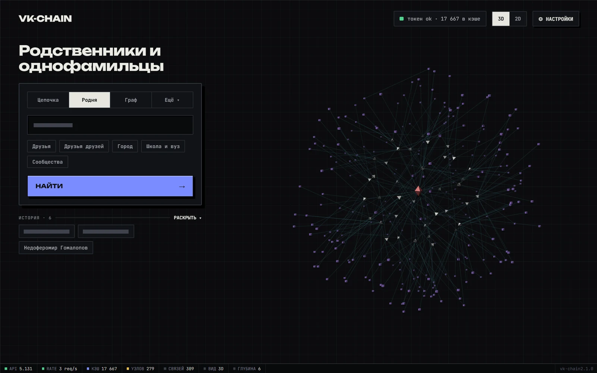
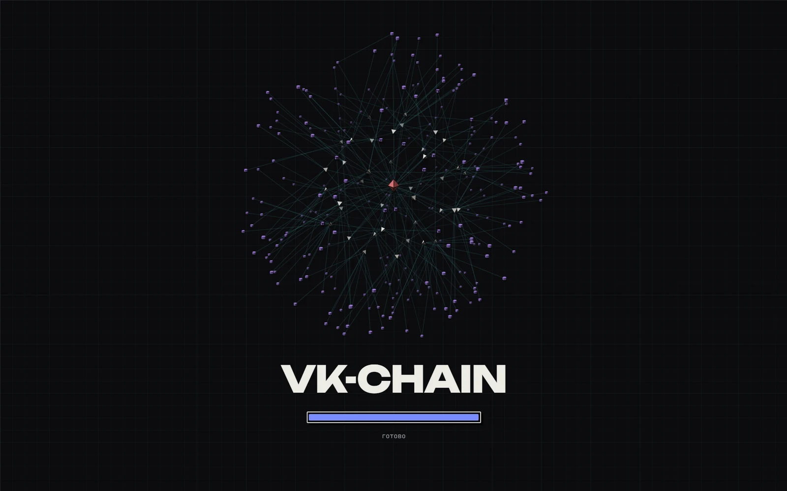

<div align="center">


# vk-chain

**Цепочки рукопожатий и интерактивный граф друзей ВКонтакте**

Узнай, через сколько людей ты связан с любым человеком во ВКонтакте,<br>
и посмотри на свою сеть знакомых — кольцами, уровень за уровнем, в 2D и 3D.

[](https://github.com/FalconTechDev/vk-chain/releases/latest)
[](https://github.com/FalconTechDev/vk-chain/releases/latest)
[](https://python.org)
[](https://dev.vk.com)
[](LICENSE)

[**Скачать для Windows**](https://github.com/FalconTechDev/vk-chain/releases/latest) · [Из исходников](#из-исходников) · [Командная строка](#командная-строка) · [Если что-то не работает](#если-что-то-не-работает)

<br>



</div>

---

## Возможности

| Режим | Что делает |
|---|---|
| **Цепочка** | Кратчайший путь между двумя людьми. Можно запросить несколько разных путей: каждый следующий обходит людей предыдущих. |
| **Граф** | Друзья и самые связанные с ними друзья друзей, до выбранного числа узлов. |
| **Родня** | Однофамильцы по корню фамилии (и по девичьей) среди **всех** друзей и друзей друзей. Берётся до 4000 кандидатов, самых связанных с твоими друзьями. |
| **Пересечения** | Общие друзья нескольких людей: id или ссылку вписываешь сам, до пяти человек. |
| **Круги общения** | Друзья, разбитые на группы по тому, кто с кем знаком. |

**Граф**

- 3D и 2D, фото профилей на узлах и в карточке человека;
- цвет связей по уровням 1, 2 и 3 отдельно: в покое и при наведении на узел;
- тумблер «Обрезать лишние связи» оставляет связи внутри кругов знакомых;
- цвета и формы узлов зависят от уровня.

**Приложение**

- полноэкранный режим, развёрнутое окно, окно без рамки или окно своего размера (**F11** переключает полный экран); выбор запоминается;
- все настройки сохраняются между запусками;
- уведомления Windows, когда долгий поиск закончен, а окно не в фокусе;
- история поисков: клик по записи повторяет запрос;
- работает без интернета, кроме самих запросов к VK: шрифты и React лежат внутри.

<div align="center">

</div>

---

## Установка

### Windows: установщик

1. Скачай `vk-chain-setup-*.exe` со страницы [Releases](https://github.com/FalconTechDev/vk-chain/releases/latest) и запусти.
2. Ставится для текущего пользователя, права администратора не нужны.
3. Открой **⚙ Настройки → Токен VK**, нажми «Получить токен в браузере» и войди во ВКонтакте.
4. Адрес, на котором ты окажешься, целиком вставь в поле и нажми «Сохранить». Токен проверяется, и только потом сохраняется.

Нужен Windows 10 или 11 с [WebView2](https://developer.microsoft.com/microsoft-edge/webview2/): в Windows 11 он уже есть.

### Из исходников

```bash
git clone https://github.com/FalconTechDev/vk-chain
cd vk-chain
pip install -r requirements.txt
python app.py
```

### Собрать установщик

```bash
python build.py
```

Нужны PyInstaller и [Inno Setup 6](https://jrsoftware.org/isdl.php). Сначала собирается программа, потом она один раз запускается в режиме самопроверки (окно открывается скрытым и проверяет, что страница поднялась без ошибок), и только после этого упаковывается `dist/vk-chain-setup-*.exe`. `python build.py --no-installer` соберёт только программу.

### Проверки

```bash
python -m unittest tests.test_backend       # бэкенд, без сети
python tests/ui_selftest.py                 # интерфейс в настоящем движке, скрытым окном
```

---

## Командная строка

Всё то же самое умеет и консольная часть, ей нужны только Python 3.9+ и `requests`.

### Токен

Получи `access_token` с правом `friends` на [vk.com/dev/access_token](https://vk.com/dev/access_token) и сохрани:

```bash
python vk_chain.py --token ТВОЙ_ТОКЕН --save
```

Токен лежит в `~/.vk_chain_token` и не попадает в репозиторий.

### Цепочка рукопожатий

```bash
python vk_chain.py <user1> <user2>
```

`user1` и `user2`: VK ID, короткое имя или ссылка `vk.com/name`.

```bash
python vk_chain.py durov id123456789          # короткие имена
python vk_chain.py 1 742860134                # ID
python vk_chain.py durov id742860134 --html   # с HTML-отчётом
```

### Родственники и однофамильцы

```bash
python vk_chain.py --relatives durov                 # похожие фамилии среди друзей и друзей друзей
python vk_chain.py --relatives durov --stem          # по корню фамилии: Иванов = Иванова = Ивановский
python vk_chain.py --relatives durov --deep --html   # глубже, с HTML-отчётом
```

Понимает транслит: `Ivanov` = `Иванов`.

### Граф в браузере

```bash
python explore.py              # или --port 5001
```

Открывается браузер с сетью, которая строится кольцами: сначала друзья, потом их друзья. Между уровнями идёт обратный отсчёт (по умолчанию 5 секунд), есть кнопки **Пауза / Продолжить / Стоп**, ползунки задержки между узлами (0,3–4 с) и паузы между уровнями (2–20 с). Клик на узел открывает панель с общими друзьями.

<details>
<summary><b>Все флаги vk_chain.py</b></summary>

```text
Поиск цепочки:
  <user1> <user2>           найти кратчайший путь между двумя людьми

Родственники:
  --relatives <user>        найти людей с похожей фамилией
  --stem                    искать по корню фамилии
  --deep                    глубокий поиск (дольше, но шире)
  --html                    сохранить и открыть HTML-отчёт

Авторизация:
  --token <tok>             VK access_token
  --save                    сохранить токен в ~/.vk_chain_token

Настройки:
  --depth <n>               глубина поиска (по умолчанию 6)
  --delay <sec>             задержка между запросами (0.35 сек)
  --no-cache                не использовать кэш
  --json                    вывод в JSON
  -v / --verbose            подробный вывод
```

</details>

---

## Как это работает

**Цепочка.** Используется двунаправленный BFS: поиск идёт одновременно от обоих людей навстречу друг другу, и когда фронты встречаются, цепочка найдена. На больших графах это в разы быстрее одностороннего обхода. Друзья каждого человека запрашиваются пачками по 25 через `execute` и сохраняются в кэш, поэтому повторные запросы к уже известным людям обходятся без обращений к VK.

**Раскладка графа в приложении.** Силовая симуляция (в духе Фрухтермана и Рейнгольда) плюс притяжение к кольцам по глубине обхода; начальное положение задают те же кольца. Лишние связи отсекаются по сходству множеств соседей (коэффициент Жаккара).

**Граф в браузере (`explore.py`).** Рисует [vis.js](https://visjs.org) без физики: узлы расставляются вручную по кольцам с радиусом `max(depth × 380, count × 70 / 2π)`. Загрузка идёт волнами: друзья центра, затем друзья уровня 1 и так далее.

---

## Если что-то не работает

<details>
<summary><b>Друзья «скрыты» или поиск ничего не находит</b></summary>

Возможно, VK ограничил частоту запросов (ошибка 29). Приложение показывает это отдельным сообщением и не кэширует пустые списки, пока лимит действует. Подожди несколько минут или увеличь задержку (`--delay` в консоли). Если друзья закрыты настройками приватности, их и правда не видно.
</details>

<details>
<summary><b>«Токен недействителен»</b></summary>

Токен из браузера живёт около 24 часов. Получи новый в **Настройки → Токен VK**.
</details>

<details>
<summary><b>Windows пишет «Неизвестный издатель» / SmartScreen</b></summary>

Установщик не подписан сертификатом. Нажми «Подробнее → Выполнить в любом случае». Исходники открыты, а установщик собирается скриптом `build.py` из этого репозитория.
</details>

<details>
<summary><b>Окно пустое или не открывается</b></summary>

Нужен рантайм WebView2 (в Windows 11 есть из коробки, для Windows 10 [скачай здесь](https://developer.microsoft.com/microsoft-edge/webview2/)). Журнал лежит в `%APPDATA%\vk-chain\app.log`.
</details>

<details>
<summary><b>Нет уведомлений</b></summary>

При включении приходит пробное. Если его нет, проверь режимы «Не беспокоить» и «Фокусировка» в Windows.
</details>

---

## Данные и приватность

Приложение ходит только в API ВКонтакте и ничего никуда больше не отправляет.

| Что | Где |
|---|---|
| Кэш, история, настройки, фото | `%APPDATA%\vk-chain` |
| Токен VK | `~/.vk_chain_token` |

Всё это, а также `friends_cache.json`, `relatives_cache.json`, `profiles.json`, `history.json`, `photos/`, `relatives_reports/` и `*.log`, лежит в `.gitignore`: чужие данные в репозиторий не попадут.

---

## Устройство репозитория

```text
vk_chain.py      поиск цепочек, родственники, HTML-отчёты (консоль)
explore.py       интерактивный граф в браузере
vk.py            обёртка над VK API: кэш, повторы, учёт лимита запросов
app.py           приложение для Windows: окно и всё, что за кнопками
ui/source/       интерфейс: разметка, логика, локальные шрифты и React
build.py         сборка программы и установщика
installer/       скрипт Inno Setup
assets/          логотип и иконка (make_logo.py рисует оба)
tests/           тесты бэкенда и интерфейса
```

---

## Лицензия

[MIT](LICENSE) © FalconTech
